<div align="center">



<br>

[](https://card-memory-game-two-eta.vercel.app)


**A calm, premium take on the classic memory game. Flip, remember, match, and beat the clock across three levels.**


</div>

---

## What it is

A single-screen memory game built to feel considered, not clip-arty. Every
card is a real 3D flip, the countdown lives in an SVG ring, and matches land
with a gold glow and streak toast. Your wins, losses and per-level best times
persist in `localStorage`, so it remembers you between visits.

## Features

- **Three levels** — Easy (4 pairs · 30s), Medium (8 · 50s), Hard (12 · 80s)
- **Live timer ring** that turns rose when you drop under 25%
- **Moves counter + combo streaks** for a bit of pressure
- **Persistent stats** — wins, losses and personal bests, saved locally
- **Fully responsive** — one column on phones, six on desktop
- **Reduced-motion aware** and keyboard/AT-labelled cards

## Design

Deep aubergine-black surfaces, a violet→gold accent story, Fraunces display
type over Space Grotesk, a fine grain overlay and spring-eased motion. No stock
gradients, no default component kit.

## Run locally

```bash
npm install
npm run dev      # http://localhost:5173
npm run build    # production build → dist/
```

## Tech

React 19 · Vite · plain CSS with custom properties · zero runtime dependencies
beyond React.

<div align="center"><sub>Built by <a href="https://github.com/TPAINN">Apostolos Peiniris</a></sub></div>
