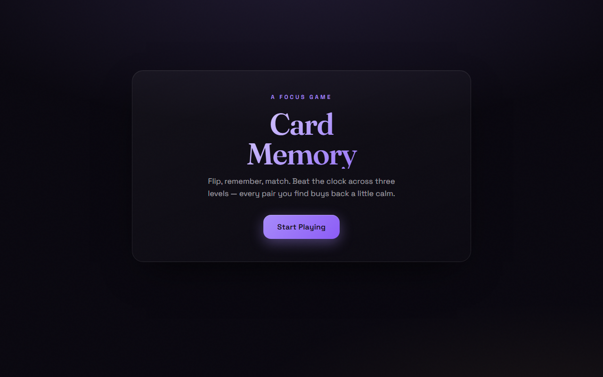

# Card Memory

A card-matching memory game with three difficulty levels, a countdown timer and saved statistics.

[Play it](https://card-memory-game-two-eta.vercel.app)



## Features

- Three levels: Easy (4 pairs, 30 s), Medium (8 pairs, 50 s), Hard (12 pairs, 80 s)
- Timer ring that turns red under 25% of the time left
- Move counter and match streaks
- Wins, losses and best times per level, saved in `localStorage`
- One column on phones, six on desktop
- Respects `prefers-reduced-motion`; cards have accessible labels
## Run locally

```bash
npm install
npm run dev      # http://localhost:5173
npm run build    # production build → dist/
```

## Tech

React 19 · Vite · plain CSS with custom properties · zero runtime dependencies
beyond React.

<div align="center"><sub>Built by <a href="https://github.com/TPAINN">Apostolos Peiniris</a></sub></div>
